<a href="https://atul-portfolio-v3.vercel.app/"></a>

<div align="center">

<a href="https://atul-portfolio-v3.vercel.app/"></a>
<a href="https://linkedin.com/in/atul-tameshwari"></a>
<a href="https://x.com/atulT09"></a>
<a href="https://instagram.com/atul.jsx"></a>

</div>

## About me

I'm a Frontend Engineer at **[Plane](https://plane.so)** in Hyderabad, India, with **3+ years** of crafting design systems, dashboards and AI-driven UX with React, TypeScript and Next.js. An engineer with a designer's eye: fast, accessible, delightful.

- **Design systems:** I'm rebuilding Propel, Plane's design system, and earlier helped migrate inFeedo's UI to a shared one
- **Accessibility:** WCAG target sizes, RTL support, ARIA semantics and contrast are part of the job, not an afterthought
- **Performance:** I watch Core Web Vitals and use code-splitting, memoization and lazy-loading so apps stay fast
- **AI-driven UX:** I've shipped AI features for enterprise HR SaaS, turning tens of millions of survey responses into insights

```ts
const atul = {
  role: "Frontend Engineer @ Plane",
  location: "Hyderabad, India",
  focus: ["Design systems", "Accessibility", "Frontend architecture"],
  stack: ["React", "TypeScript", "Next.js", "Tailwind CSS"],
  sideProject: "Tern: know when it's your turn",
  offline: "riding bikes in the hills 🏍️",
};
```

## Experience

**Software Development Engineer, Frontend · [Plane](https://plane.so)** · _May 2026 – Present_
- Rebuilt **Propel**, Plane's design system: redesigned 30+ React/TypeScript components against a new Figma spec, with WCAG target sizes, RTL support and accessible group semantics
- Architected **`@plane/blocks`**, a shared component layer that unifies Plane's public Space surface with the main web app
- Consolidated duplicated component and store code between Plane's community and core editions into a single shared tree

**Software Developer, Frontend · [inFeedo.ai](https://www.infeedo.ai)** · _Mar 2022 – Mar 2025_ (intern until May 2022)
- Helped build and scale a shared design system and migrated most UI components to it
- Shipped AI-driven features for an enterprise HR SaaS used by hundreds of CHROs, with insights from tens of millions of responses
- Led dashboard architecture improvements and owned production issues end to end

## Featured projects

| Project | What it is | Built with |
| --- | --- | --- |
| [**Tern**](https://github.com/codingwolf-at/tern) · [site](https://tern-site.vercel.app) | Native macOS menu bar app that tells you when it's your turn across GitHub, Plane, AI agents and Calendar | Swift, SwiftUI |
| [**HireTrack**](https://github.com/codingwolf-at/hiretrack) · [live](https://hiretrack-ruddy.vercel.app) | Job application tracking dashboard with auth, live metrics and pipeline stages | Next.js, TypeScript, Supabase |
| [**ReviewUI**](https://github.com/codingwolf-at/ai-ui-reviewer) · [live](https://ai-ui-reviewer.vercel.app) | Reviews UI code and screenshots with AI and returns UX, accessibility and code-quality feedback | Next.js, OpenRouter AI |
| [**Crescent UI**](https://github.com/codingwolf-at/crescent-ui) · [live](https://crescent-ui.netlify.app) | Lightweight CSS component library served from a CDN, with no framework lock-in | HTML, CSS |

## Tech stack

<div align="center">

**Frontend**


**Backend, native and tools**


</div>

## Activity

<p align="center">
  
</p>

<p align="center">
  
</p>

<p align="center">
  
</p>

<p align="center">
  
</p>

